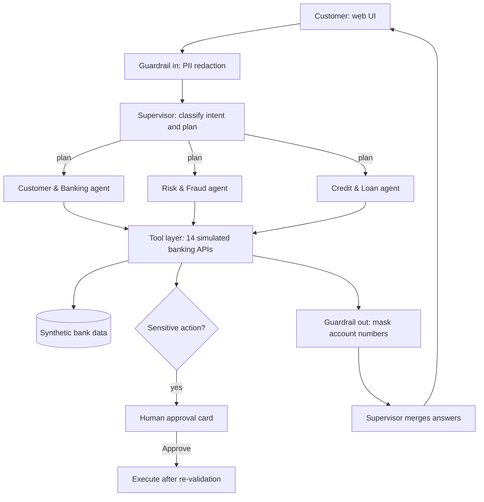

# Architecture and approach

## 1. The problem
Show how several AI agents can cooperate inside a simulated bank. A customer types a normal sentence, and the system must work out
who should handle it, fetch real data through banking APIs, and answer safely.

## 2. The idea in one paragraph
A **Supervisor agent** reads each request and builds a plan. It sends the work to one or more **specialist agents** (Customer & Banking,
Risk & Fraud, Credit & Loan). Each specialist can only use its own **tools** (simulated banking APIs). Anything that changes money or
card state is **never executed by the AI**: it creates a request that the human must approve. Guardrails clean the input and output.
The UI shows all of this live, so the architecture is visible, not hidden behind a chat box.

## 3. Diagram

## 4. Mapping to the reference architecture
| Reference layer | What this MVP does |
|---|---|
| 1. Channels | Web UI (one channel) |
| 2. API and experience | FastAPI, streaming events as newline-delimited JSON. Login/OAuth not built (one demo customer, assumed authenticated) |
| 3. AI gateway / control plane | PII detection and redaction, output masking, policy checks (transfer limit), human-in-the-loop, model routing (small model for routing, larger for agents) |
| 4. Multi-agent orchestrator | Supervisor: intent classification, task decomposition, agent selection, result aggregation, error recovery (offline fallback) |
| 4. Agents | 3 of the 9 in the diagram: Customer, Risk/Fraud, Credit |
| 5. Tool / MCP layer | 14 typed tools with JSON schemas, per-agent permission boundary, approval gate, every call logged |
| 6. Enterprise data | In-memory synthetic customer, accounts, cards, transactions, loans |
| 7. Knowledge / RAG, 8. External services | Not built (listed as next steps) |
| 9. Observability | "Flight recorder": every event timestamped, tool latency, raw responses |

## 5. How a request flows
1. **Guardrail in.** Card or account-like numbers are replaced with `[REDACTED-NUMBER]` before any model sees them.
2. **Supervisor routes.** A small, fast model is forced to call a `route_request` tool, so the plan is structured data: intent, reasoning, and an ordered list of `{agent, task}`. Chit-chat gets a direct reply.
3. **Specialists work.** Each agent runs a tool-use loop (maximum 6 steps): the model asks for a tool, the tool runs, the result goes back, repeat until it writes an answer.
4. **Sensitive actions pause.** `transfer_funds` and `block_card` validate against policy and then create a pending action. The model is told it is awaiting approval. Only the user's click on the `/decision` endpoint executes it, after validating again, and it cannot be replayed.
5. **Guardrail out.** Account numbers and mobiles in tool results are masked.
6. **Merge.** If several agents ran, the Supervisor writes one combined answer.

## 6. Design decisions and why
| Decision | Reason |
|---|---|
| Supervisor plus specialists | Small focused agents are easier to test, and a mistake stays contained |
| Forced tool call for routing | The plan is structured JSON, not prose that has to be parsed |
| Least-privilege tools per agent | The Credit agent cannot block cards; the Risk agent cannot move money |
| Numbers come from tools, not the LLM | Risk scores, EMI and eligibility are deterministic, so the model cannot invent figures |
| Explainable fraud rules | Each signal (foreign country, odd hour, unusual amount, new merchant, duplicate) adds points and a plain-English reason |
| Human approval by construction | The model has no code path that moves money |
| Live and offline modes share one event format | The demo never breaks, tests need no API key, and the UI cannot tell the difference |
| Model choice is configuration | `SUPERVISOR_MODEL` and `AGENT_MODEL` can point at any model, including experimental ones |

## 7. Testing
11 automated tests run fully offline: routing, fraud flags, human approval, rejection, policy block, loan decisions, multi-agent
requests, PII redaction and masking, and replay protection.

## 8. Limitations and next steps
- In-memory data, one demo customer, no authentication.
- Agents run one after another, not in parallel.
- The offline router is keyword-based; live routing is the real LLM path.
- Next: parallel agents, Compliance/KYC agent, RAG over policy documents, a routing-accuracy evaluation set, a real database,
  authentication, and cost/latency dashboards.
