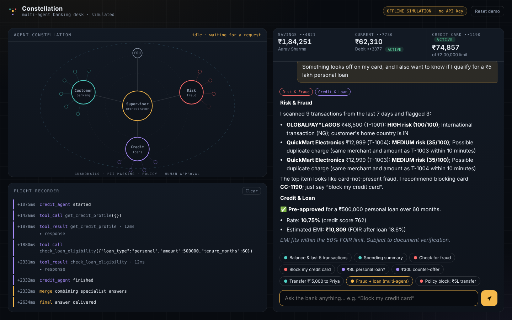

# Constellation: a multi-agent banking desk 

A working MVP of a real-time banking assistant where a **Supervisor agent** routes natural-language requests to
**three specialist agents** that call **simulated banking APIs**. Built for the Wrench Wise AI/ML internship assignment.



## What makes it different
Instead of a plain chat box, the UI is a **live "constellation"**: the Supervisor sits at the centre, each agent is a node, and every
tool is a small satellite that lights up the instant it is called. Next to it, a **flight recorder** logs every routing decision,
tool call, guardrail hit and approval in order, with the raw JSON one click away. You can *see* the agent architecture working.

## Quick start 
```bash
cd constellation-bank
python3 -m venv .venv && source .venv/bin/activate      # optional
pip install -r requirements.txt
cp .env.example .env                                     # optional: add ANTHROPIC_API_KEY for live mode
python3 -m uvicorn backend.main:app --port 8000
# open http://localhost:8000
python3 -m pytest -q tests                               # 11 offline tests
```
**Two modes, one UI.** With `ANTHROPIC_API_KEY` set it runs **live** (Claude tool-use agents). Without a key it runs an
**offline simulation** (rule-based router and scripted agents calling the same tools), so the demo always works. If the API fails
mid-request the app falls back to offline automatically. The badge top-right shows which mode you are in.
Models are configurable (`SUPERVISOR_MODEL`, `AGENT_MODEL`), so you can point the agents at an experimental model by changing one env var.

## Architecture 
| Reference layer | In this MVP |
|---|---|
| 1-2 Channels / API layer | Web UI + FastAPI, NDJSON event streaming (`backend/main.py`) |
| 3 AI gateway / control plane | PII redaction on input, PII masking on tool output, policy checks, human-in-the-loop (`tools.py`, `orchestrator.py`) |
| 4 Multi-agent orchestrator | Supervisor: intent classification, task decomposition, agent selection, result aggregation, graceful fallback |
| 4 Agents | **Customer & Banking**, **Risk & Fraud**, **Credit & Loan** |
| 5 Tool / MCP layer | 14 typed tools with JSON schemas, per-agent permission boundary, approval gate for sensitive tools |
| 6 Enterprise data | In-memory synthetic customer, accounts, cards, transactions, loans (`data.py`) |
| 9 Observability | Flight recorder: every event timestamped, tool latency, raw responses |

### How a request flows
1. **Guardrail in**: card/account-like numbers are redacted before any model sees them.
2. **Supervisor** (Claude via a forced `route_request` tool call) returns intent, reasoning and an ordered plan of `{agent, task}`; non-banking chat gets a direct reply.
3. Each **specialist** runs its own tool-use loop (max 6 steps) restricted to *its* tools only.
4. **Sensitive tools** (`transfer_funds`, `block_card`) never execute directly. They validate against policy (for example the ₹2,00,000 transfer limit), then create a pending action; the user must click **Approve**. Approval re-validates before executing and cannot be replayed.
5. **Guardrail out**: account numbers and mobiles in tool results are masked.
6. If several agents ran, the Supervisor **merges** their answers into one reply.

## Use cases to try (also the chips in the UI)
1. **Balance and recent transactions** (Customer agent)
2. **Spending summary** (Customer agent)
3. **Fraud scan**: flags a ₹48,500 Lagos charge at 3 am (score 100, HIGH) and a duplicate ₹12,999 charge (Risk agent)
4. **Block card** with human approval, then the card flips to BLOCKED in the header (Risk agent)
5. **Loan eligibility** with FOIR rule: ₹8L pre-approved; ₹30L gets a **counter-offer** with the maximum eligible amount (Credit agent)
6. **Transfer** to a saved payee with approval; ₹5L is blocked by **policy**
7. **Multi-agent**: "Something looks off on my card, and can I get a ₹5 lakh loan?" goes to Risk, then Credit, then merged

## Design decisions 
- **Supervisor uses forced tool-calling** for routing, so the plan is structured JSON, not parsed prose.
- **Tool boundaries per agent** (least privilege): the Credit agent cannot block cards; the Risk agent cannot move money.
- **Deterministic numbers**: all figures (risk scores, EMI, eligibility) come from tools, never from the LLM.
- **Fraud scoring is explainable**: rule-based signals (foreign country, odd hour, amount vs card average, new merchant, duplicates) each add points and a human-readable reason.
- **Human-in-the-loop by construction**: the LLM cannot cause a side effect; only the `/decision` endpoint can.
- **Mode parity**: live and offline modes emit the same event protocol, so the UI and tests do not care which is active.

## Known limits / next steps
In-memory state and a single demo customer; no auth; sequential (not parallel) agents; offline router is keyword-based.
Next: parallel agent execution, a Compliance/KYC agent, RAG over policy documents, evaluation harness for routing accuracy, persistent store.

## Project layout
```
backend/  data.py (synthetic data) · tools.py (APIs + guardrails) · orchestrator.py (supervisor + agents) · main.py (FastAPI)
frontend/ index.html · app.css · app.js (constellation, flight recorder, chat)
tests/    test_offline.py
```
